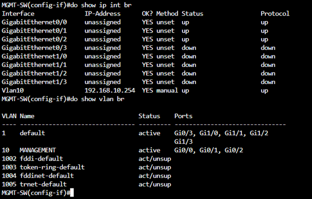
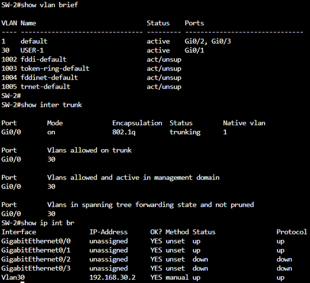

# Cisco Network Automation with Python & Netmiko

### Automating OSPF Routing and VLAN Configuration in Cisco Modeling Labs (CML)

## Project Overview

This project demonstrates how Python and Netmiko can be used to automate network configuration and verification tasks within a simulated enterprise network built using Cisco Modeling Labs (CML).

The lab consists of two Cisco routers, two access switches, a management switch, an Ubuntu Linux automation server, and two endpoint PCs.

Rather than manually configuring every network device, I developed Python scripts to establish SSH connections, deploy OSPF routing configurations, create VLANs, and retrieve network verification outputs.

The project was completed in two phases:

- **Phase 1:** Automating OSPF routing between Cisco routers.
- **Phase 2:** Automating VLAN creation and interface assignments on Cisco switches.

## Technologies & Tools

| Technology | Purpose |
|---|---|
| Cisco Modeling Labs (CML) | Network simulation environment |
| Python 3 | Network automation scripting |
| Netmiko | SSH-based device configuration |
| Cisco IOS XE | Router operating system |
| Cisco IOS | Switch configuration |
| Ubuntu Linux | Centralized automation server |
| OSPF | Dynamic routing between routers |
| IEEE 802.1Q | VLAN tagging and trunking |
| SSHv2 | Secure remote device management |

---

## Network Topology

The network consists of the following devices:

- 2 Cisco routers (R1 and R2)
- 2 Cisco access switches (SW-1 and SW-2)
- 1 management switch (MGMT-SW)
- 1 Ubuntu Linux automation server
- 2 endpoint PCs

The management network provides SSH connectivity between the automation server and the Cisco devices.

### Topology Diagram


### IP Addressing Scheme

| Device | Interface | IP Address |
|---|---|---|
| Ubuntu Server | ens2 | 192.168.10.10/24 |
| MGMT-SW | VLAN 10 | 192.168.10.254 |
| R1 | GigabitEthernet1 | 192.168.10.1 |
| R2 | GigabitEthernet1 | 192.168.10.2 |
| R1 | GigabitEthernet2.20 | 192.168.20.1 |
| R2 | GigabitEthernet2.30 | 192.168.30.1 |
| SW-1 | VLAN 20 | 192.168.20.2 |
| SW-2 | VLAN 30 | 192.168.30.2 |
| R1 | GigabitEthernet2.40 | 192.168.40.1 |
| R2 | GigabitEthernet2.50 | 192.168.50.1 |

---

## 1. Initial Network Configuration

Before implementing automation, I manually configured the underlying network infrastructure to establish connectivity between the Ubuntu server and Cisco devices.

### Ubuntu Server Configuration

The Ubuntu server was configured with a static management IP address using Netplan.

```yaml
network:
  version: 2
  ethernets:
    ens2:
      dhcp4: false
      addresses:
        - 192.168.10.10/24
    ens3:
      dhcp4: true
```

The server uses the management network to establish SSH sessions with the Cisco devices.

### Management Switch Configuration

A dedicated management VLAN was created to provide connectivity between the Ubuntu server and network devices.

- **VLAN 10:** MANAGEMENT
- **Management SVI:** 192.168.10.254
- **Management ports:** Assigned to VLAN 10

Configuration was verified using:

```text
show ip interface brief
show vlan brief
```

### Management Switch Verification



### SSH Configuration

SSHv2 was configured on the Cisco routers to allow Python scripts to connect securely using Netmiko.

Example commands:

```text
ip ssh version 2
crypto key generate rsa modulus 3072

line vty 0 4
login local
transport input ssh
```

Local user credentials were configured separately to support SSH authentication.

Similar SSH configurations were applied to both routers.

### SSH Verification


---

## 2. VLANs and Inter-VLAN Routing

The initial network included two user VLANs.

| VLAN | Name | Network | Device |
|---|---|---|---|
| 20 | Existing User VLAN | 192.168.20.0/24 | SW-1 |
| 30 | USER-1 | 192.168.30.0/24 | SW-2 |

802.1Q trunk links were configured between the routers and their respective switches.

Router-on-a-stick subinterfaces provided the default gateways for each VLAN.

### Example: R1 VLAN 20

```text
interface GigabitEthernet2.20
 encapsulation dot1Q 20
 ip address 192.168.20.1 255.255.255.0
```

### Example: R2 VLAN 30

```text
interface GigabitEthernet2.30
 encapsulation dot1Q 30
 ip address 192.168.30.1 255.255.255.0
```

### Verification Commands

```text
show vlan brief
show interfaces trunk
show ip interface brief
```

### VLAN and Trunk Verification



---

## 3. Phase 1 — Automating OSPF with Python

### Objective

Automate the deployment of OSPF routing configurations across two Cisco routers using Python and Netmiko.

OSPF was implemented to enable dynamic route advertisement between the networks connected to R1 and R2.

### Automation Workflow

1. Store router connection information in a centralized Python inventory.
2. Establish SSH sessions using Netmiko's `ConnectHandler`.
3. Enter privileged EXEC mode.
4. Deploy OSPF configurations using `send_config_set()`.
5. Save configurations to the devices.
6. Verify OSPF neighbor relationships and routing information.

### OSPF Configuration — R1

```text
router ospf 1
 router-id 1.1.1.1
 passive-interface default
 no passive-interface GigabitEthernet1
 network 192.168.10.0 0.0.0.255 area 0
 network 192.168.20.0 0.0.0.255 area 0
```

### OSPF Configuration — R2

```text
router ospf 1
 router-id 2.2.2.2
 passive-interface default
 no passive-interface GigabitEthernet1
 network 192.168.10.0 0.0.0.255 area 0
 network 192.168.30.0 0.0.0.255 area 0
```

Passive interfaces were used to advertise the user networks without attempting to establish OSPF neighbor relationships with endpoint devices.

### Python Automation Script

The OSPF automation script uses Netmiko to establish SSH connections and deploy routing configurations.

**Script:** [configure_ospf.py](scripts/configure_ospf.py)

The script performs the following operations:

- Retrieves device connection information from `inventory.py`.
- Establishes SSH connections to R1 and R2.
- Enters privileged EXEC mode.
- Sends the required OSPF configuration commands.
- Saves the configuration changes.

### OSPF Verification

The following commands were used to verify the OSPF configuration:

```text
show ip ospf neighbor
show ip route ospf
show ip protocols
show ip interface brief
```

### OSPF Neighbor Verification


### OSPF Automation Output


### Video Demonstration

**YouTube:** [Watch OSPF Automation Demo](YOUR_OSPF_VIDEO_URL)

---

## 4. Phase 2 — Automating VLAN Configuration

### Objective

Expand the existing network by automating the creation of additional VLANs using Python and Netmiko.

The automation was designed to create VLANs on their respective switches and assign them to designated access interfaces.

### New VLANs

| Device | VLAN ID | VLAN Name | Network |
|---|---|---|---|
| SW-1 | 40 | ENGINEERING | 192.168.40.0/24 |
| SW-2 | 50 | OPERATIONS | 192.168.50.0/24 |

### VLAN Automation Workflow

1. Define VLAN configuration commands in a Python dictionary.
2. Retrieve switch connection details from the inventory.
3. Establish SSH sessions with SW-1 and SW-2.
4. Create VLAN 40 on SW-1 and VLAN 50 on SW-2.
5. Assign the new VLANs to the designated switch interfaces.
6. Save the configurations.
7. Retrieve VLAN tables to verify the changes.

### Python Automation Script

**Script:** [configure_vlan.py](scripts/configure_vlan.py)

The script uses a dictionary to associate each switch's management IP address with its required configuration commands.

```python
from netmiko import ConnectHandler
from inventory import get_devices

vlan_configs = {
    "192.168.20.2": [
        "vlan 40",
        "name ENGINEERING",
        "interface GigabitEthernet0/2",
        "switchport mode access",
        "switchport access vlan 40",
    ],
    "192.168.30.2": [
        "vlan 50",
        "name OPERATIONS",
        "interface GigabitEthernet0/2",
        "switchport mode access",
        "switchport access vlan 50",
    ],
}

for device in get_devices(["SW-1", "SW-2"]):
    print(f"\nConfiguring VLANs on {device['host']}")

    with ConnectHandler(**device) as conn:
        conn.enable()

        output = conn.send_config_set(
            vlan_configs[device["host"]]
        )

        print(output)
        conn.save_config()

print("\nVLAN configuration completed.")
```

### Router Subinterface Configuration

Additional router-on-a-stick subinterfaces were configured to provide default gateways for the new VLANs.

**R1 — VLAN 40**

```text
interface GigabitEthernet2.40
 encapsulation dot1Q 40
 ip address 192.168.40.1 255.255.255.0
```

**R2 — VLAN 50**

```text
interface GigabitEthernet2.50
 encapsulation dot1Q 50
 ip address 192.168.50.1 255.255.255.0
```

### OSPF Network Advertisement

The new VLAN networks were added to OSPF to enable dynamic route advertisement.

**R1**

```text
router ospf 1
 network 192.168.40.0 0.0.0.255 area 0
```

**R2**

```text
router ospf 1
 network 192.168.50.0 0.0.0.255 area 0
```

### VLAN Verification

The following commands were used to inspect VLAN configurations and interface status:

```text
show vlan brief
show interfaces trunk
show ip interface brief
```

### VLAN Automation Output


### VLAN Table Verification


### Video Demonstration

**YouTube:** [Watch VLAN Automation Demo](YOUR_VLAN_VIDEO_URL)

---

## 5. Project Structure

The automation scripts are organized into separate files to simplify configuration management and verification.

```text
Cisco-Network-Automation-with-Python-and-Netmiko/
│
├── README.md
├── requirements.txt
├── .gitignore
│
├── scripts/
│   ├── inventory.py
│   ├── configure_ospf.py
│   ├── configure_vlan.py
│   ├── show_interfaces.py
│   └── show_vlans.py
│
└── screenshots/
    ├── network-topology.png
    ├── management-switch.png
    ├── ssh-configuration.png
    ├── initial-vlans.png
    ├── ospf-neighbors.png
    ├── ospf-automation.png
    ├── vlan-automation.png
    └── vlan-table.png
```

### File Descriptions

| File | Description |
|---|---|
| inventory.py | Stores device connection information and retrieves SSH credentials |
| configure_ospf.py | Automates OSPF routing configuration |
| configure_vlan.py | Automates VLAN creation and interface assignments |
| show_interfaces.py | Retrieves interface status information |
| show_vlans.py | Retrieves VLAN tables |
| requirements.txt | Lists required Python dependencies |

---

## 6. Running the Automation Scripts

### Prerequisites

Before running the scripts, ensure that:

- The Cisco CML topology is operational.
- SSH connectivity is established between the Ubuntu server and Cisco devices.
- Python 3 is installed.
- Netmiko is installed.
- Device management IP addresses are reachable.

### Step 1 — Create a Python Virtual Environment

```bash
python3 -m venv venv
source venv/bin/activate
```

### Step 2 — Install Dependencies

```bash
pip install netmiko
```

### Step 3 — Execute OSPF Automation

```bash
cd scripts
python3 configure_ospf.py
```

### Step 4 — Execute VLAN Automation

```bash
python3 configure_vlan.py
```

### Step 5 — Verify Configurations

```bash
python3 show_interfaces.py
python3 show_vlans.py
```

**Note:** Device inventory details and SSH credentials must be configured appropriately before running the scripts. Do not commit passwords, enable secrets, or private keys to GitHub.

---

## 7. Key Skills Demonstrated

This project provided hands-on experience with the following technologies and concepts:

- **Network Automation:** Developing Python scripts to configure multiple Cisco network devices.
- **Python & Netmiko:** Establishing SSH connections, executing commands, and retrieving device outputs.
- **Dynamic Routing:** Configuring OSPF area 0 and advertising multiple networks.
- **VLAN Management:** Creating VLANs and assigning switch interfaces.
- **Inter-VLAN Routing:** Configuring 802.1Q router subinterfaces.
- **Linux Administration:** Preparing an Ubuntu automation server and managing Python virtual environments.
- **Network Verification:** Using Cisco show commands to validate routing and switching configurations.

---

## 8. Project Takeaways

This project allowed me to apply Python programming to real-world network engineering tasks in a simulated enterprise environment.

By automating OSPF routing and VLAN configuration, I gained practical experience using Netmiko to manage multiple Cisco devices through SSH.

Separating device inventory, configuration scripts, and verification scripts also provided a reusable foundation for future network automation projects.

**Focus Areas:** Network Engineering | Python | Netmiko | OSPF | VLANs | Network Automation
